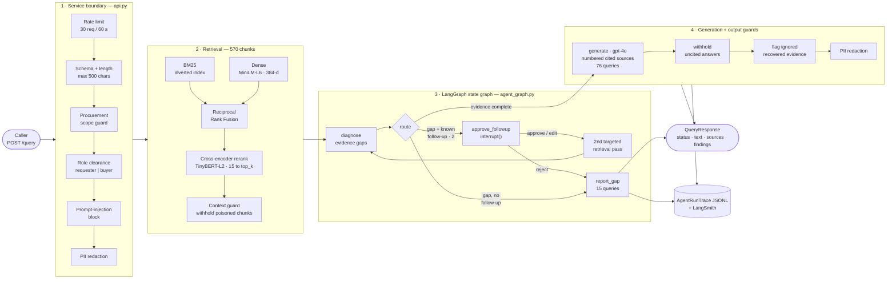

# ProcureRAG

**A production-shaped RAG system for procurement knowledge — built from primitives, then measured at every layer.**

ProcureRAG answers procurement questions ("What approval is required for a EUR 60,000
purchase order?") from a synthetic corporate knowledge base of policies, procedures,
supplier contracts and FAQs. Retrieval is written by hand — TF-IDF, BM25, an inverted
index, dense embeddings, Reciprocal Rank Fusion, cross-encoder reranking — so the
trade-off between lexical and dense retrieval is visible in the code rather than hidden
behind a library call. Frameworks (LangGraph, LangChain, DeepEval, RAGAS, FastAPI) are
layered on top only where they earn their place, and the reason is written down.

The thing that distinguishes this repo is not the feature list: it is that **every claim
has a number and a documented limit.** Nine retrieval configurations are scored on a
93-query labeled set with graded relevance; the reranker's weakest query slice is
measured, root-caused to two specific queries, and used to motivate the agentic layer;
the guardrails are mutation-tested; the container is probed offline. Where something
does not work — and several things do not — it is in
[Known limits](#known-limits--not-built-yet), not quietly omitted.

```
Python 3.11 · uv · numpy · sentence-transformers · LangGraph 1.2 · LangChain 1.4
FastAPI · Uvicorn · Pydantic v2 · DeepEval · RAGAS · LangSmith · Docker
357 tests · ruff clean · no LLM credentials needed to run the suite
```

---

## Contents

- [What this demonstrates](#what-this-demonstrates)
- [Architecture](#architecture)
- [Measured results](#measured-results)
- [Where it still fails](#where-it-still-fails)
- [Corpus and golden query set](#corpus-and-golden-query-set)
- [Quickstart](#quickstart)
- [API surface](#api-surface)
- [Repo map](#repo-map)
- [How this was built](#how-this-was-built)
- [Known limits / not built yet](#known-limits--not-built-yet)
- [Documentation index](#documentation-index)

---

## What this demonstrates

| Capability | Implementation | Evidence |
|---|---|---|
| **Lexical retrieval from scratch** | Inverted index, TF-IDF, BM25 — no retrieval library | [`src/retrieval.py`](src/retrieval.py) · [eval report](docs/eval-report.md#baseline-table-unfiltered-text-retrieval) |
| **Dense retrieval** | `multi-qa-MiniLM-L6-cos-v1` embeddings, cosine similarity, hand-rolled | [`src/semantic_search.py`](src/semantic_search.py) |
| **Chunking** | Sentence-window chunks (3 sentences, overlap 1), 34 docs → 570 chunks | [`src/chunking.py`](src/chunking.py) · [`src/chunked_search.py`](src/chunked_search.py) |
| **Hybrid fusion** | RRF and weighted fusion over BM25 + dense, at document *and* chunk granularity | [`src/hybrid_search.py`](src/hybrid_search.py) |
| **Two-stage reranking** | Cross-encoder (`ms-marco-TinyBERT-L2-v2`) over a 15-chunk shortlist, every first-stage score preserved for audit | [`src/reranking.py`](src/reranking.py) |
| **Retrieval evaluation** | P@1 / R@5 / MRR@10 / nDCG@5, nine methods, 93 queries, plus error slices by query type, difficulty and filter | [`src/eval_metrics.py`](src/eval_metrics.py) · [eval report](docs/eval-report.md) |
| **Grounded generation** | Numbered source contract; every `[n]` traced back to a real chunk or flagged as an orphan citation | [`src/generation.py`](src/generation.py) |
| **Generation evaluation** | Four deterministic checks (citation validity, context recall, completeness, grounding) | [`src/generation_eval.py`](src/generation_eval.py) |
| **LLM-as-judge** | DeepEval + RAGAS faithfulness and contextual recall, with an honest `skipped`/`blocked`/`ok`/`error` contract | [`src/framework_eval.py`](src/framework_eval.py) |
| **Error analysis** | A failure taxonomy over five real cases, each with a human-assigned root cause and an owner (retrieval vs. generation) | [`src/error_analysis.py`](src/error_analysis.py) |
| **Regression suite** | Frozen cases that fail loudly when retrieval drifts, including a *tracked, expected* gap | [`src/regression_suite.py`](src/regression_suite.py) |
| **Agentic retrieval** | A bounded one-extra-pass recursive loop, triggered by computed evidence gaps — never by re-reading generated prose | [`src/agentic_retrieval.py`](src/agentic_retrieval.py) |
| **State graph** | The same control flow as an explicit LangGraph `StateGraph` with a deterministic router | [`src/agent_graph.py`](src/agent_graph.py) |
| **Checkpointing / HITL / time travel** | `InMemorySaver`, `interrupt()` approval gate (approve / edit / reject), state replay per `thread_id` | [`src/agent_control_plane.py`](src/agent_control_plane.py) |
| **Observability + structured output** | Pydantic-validated `AgentRunTrace` (JSONL, versioned schema) and `AgentResult`; LangSmith root runs linked to local rows | [`src/agent_observability.py`](src/agent_observability.py) · [traces](docs/traces/) |
| **Guardrails** | One guard per layer — input, retrieved context, action, output — mapped to the OWASP LLM Top 10 (2025) | [`src/agent_guardrails.py`](src/agent_guardrails.py) · [mapping](docs/eval-report.md#owasp-top-10-for-llm-apps-2025-procurerag-mapping) |
| **Serving** | FastAPI with SSE streaming, role-based confidentiality filtering, rate limiting, scope guard | [`src/api.py`](src/api.py) |
| **Containerization** | Non-root image, CPU-only `torch`, offline model-cache volume, secret boundary, health check | [`Dockerfile`](Dockerfile) · [runbook](docs/docker-runbook.md) |

---

## Architecture



The route distribution over the 93 labeled queries is **76 direct `generate` / 2
approval-gated second pass / 15 `report_gap`** — measured, not designed. The two
second-pass queries (Q091, Q092) are exactly the two failures the Week 3 evaluation
root-caused; `report_gap` is what the system does instead of answering when required
evidence never reached context.

**Design decisions worth asking about:**

- **Low-level `StateGraph`, not `create_agent`.** There is no tool-calling model loop to
  wrap: the router is deterministic code, and the only action is one extra retrieval
  pass. The trade-off is written up in [Day 18](docs/eval-report.md#current-api-decision-low-level-stategraph-vs-create_agent) rather than papered over.
- **Hybrid guardrails.** LangChain's `PIIMiddleware` detectors where one fits (the card
  detector runs Luhn, so a 16-digit reference number is not mistaken for a card), local
  regex where none does. Guardrails AI and Presidio were deliberately *not* adopted —
  both need network installs or model downloads, so neither runs in CI.
- **Chunk-level fusion before reranking.** The reranker is benchmarked against the
  strongest first stage (chunk-level hybrid RRF), not a weaker one that would flatter it.

---

## Measured results

Nine retrieval configurations, all 93 labeled queries, 34 documents, 570 chunks.
Reproduce with `uv run python src/eval_metrics.py` (~16 s on a laptop CPU).

| Method | Retrieval unit | P@1 | R@5 | MRR@10 | nDCG@5 |
|---|---|---:|---:|---:|---:|
| TF-IDF | document | 0.871 | 0.787 | 0.924 | 0.818 |
| BM25 | document | 0.860 | 0.754 | 0.910 | 0.792 |
| Dense (multi-qa-MiniLM) | document | 0.839 | 0.673 | 0.900 | 0.740 |
| Dense (multi-qa-MiniLM) | chunk→document | 0.925 | 0.768 | 0.954 | 0.828 |
| Hybrid RRF (BM25 + dense) | document | 0.860 | 0.763 | 0.922 | 0.799 |
| Hybrid weighted, α=0.5 | document | 0.882 | 0.775 | 0.938 | 0.822 |
| Hybrid RRF (BM25 + dense) | chunk→document | 0.935 | **0.811** | 0.965 | 0.863 |
| Hybrid weighted, α=0.5 | chunk→document | 0.925 | 0.801 | 0.961 | 0.851 |
| **Cross-encoder reranked Hybrid RRF** | chunk→document | **0.978** | 0.806 | **0.984** | **0.869** |

Relevance is binary via `expected_relevant_ids` for P@1/R@5/MRR@10, and graded
(primary = 2, secondary = 1) for nDCG@5. Every ranked list is cut to depth 10 before
scoring, so MRR is MRR@10, not an unbounded MRR. Full methodology, the filter-adjusted
table, and the tie-break analysis are in [`docs/eval-report.md`](docs/eval-report.md).

**What the numbers actually say:**

- **Changing the retrieval unit beat changing the algorithm.** Moving dense retrieval
  from whole documents to chunks is +0.086 P@1 — a bigger gain than any fusion method
  delivered at document level. Hybrid fusion only earns its place *once it fuses over
  the right unit*: at document level, hybrid RRF (0.860) does not beat TF-IDF (0.871).
- **The reranker is a precision tool, not a recall tool.** P@1 +0.043 and MRR@10 +0.019,
  while R@5 moves −0.005. That is the expected shape: reranking only re-orders the same
  15-chunk shortlist, so it cannot pull in a document the first stage never retrieved.
  A sharp P@1 gain alongside flat R@5 is evidence the reranker is doing its own job
  rather than compensating for a weak first stage.
- **nDCG@5 breaks every P@1 tie and shows the remaining headroom.** The reranked row is
  0.978 P@1 but only 0.869 nDCG@5: ranking the *primary* document first is a measurably
  harder bar than ranking *any* relevant document first.

Serving and container measurements (one machine, `linux/arm64`, n=10, LLM off):

| Measurement | Value |
|---|---|
| Image size | 1.87 GB (down from 6.58 GB — see below) |
| Cold start to `healthy` | 9 s published, 10 s with `--network none` |
| Warm `/health` | median 2.7 ms |
| Warm `/query` (single pass) | median 39.3 ms |
| Two-pass `/query` (Q091 + approve) | 99 ms |
| Steady memory, one worker | 572 MiB |

> **A finding worth the space:** the first image was 6.58 GB, and 4.2 GiB of that — 67%
> of the virtualenv — was CUDA libraries that a CPU-only service never loads. PyPI's
> Linux `torch` wheel is the CUDA build. Pointing `torch` at PyTorch's CPU-only index
> for Linux only ([`pyproject.toml`](pyproject.toml)) cut the image to 1.87 GB with
> identical retrieval results. The subtlety: `[tool.uv.sources]` applies to *direct*
> dependencies only, so `torch` has to be listed explicitly even though ProcureRAG never
> imports it — leave it out and Linux silently gets the CUDA build back.

---

## Where it still fails

This section exists because an aggregate number hides the interesting part.

**`multi_doc` is the reranker's weakest slice, and the only one where it loses to its own
first stage.** Error slices by query type (`src/eval_metrics.py`):

| Query type | n | Hybrid RRF chunk→doc (P@1) | Reranked (P@1) |
|---|---:|---:|---:|
| conceptual | 17 | 0.941 | 1.000 |
| lookup | 23 | 0.957 | 1.000 |
| **multi_doc** | 5 | 0.800 | **0.600** |
| numeric | 7 | 0.857 | 1.000 |
| procedural | 14 | 0.929 | 1.000 |
| supplier_specific | 13 | 1.000 | 1.000 |
| terminology | 6 | 1.000 | 1.000 |
| threshold | 8 | 0.875 | 1.000 |

Traced to two specific queries rather than left as a slice-level observation:

- **Q091** ("What approvals and security evidence do I need for a EUR 120,000 SaaS
  renewal?") retrieves `POL-001`, but not the *chunk* carrying the actual Band 3
  threshold sentence. The answer therefore cannot state the threshold — and correctly
  says so instead of guessing.
- **Q092** ("What do we need to complete before a new cleaning contractor starts on
  site?") misses `CONTRACT-005` and `POL-002` entirely, at document level. Two different causes: a
  reranker-judgment miss a bigger pool cannot fix, and a fusion+reranker miss that a
  diagnostic `pool_size=200` still left outside the cutoff.

**What fixed them was not depth.** A second retrieval pass with a query reformulated
from the missing clauses' own vocabulary ("Enhanced Due Diligence", "Legal approval",
"recruitment fees") recovered Q091's missing chunk and both of Q092's missing documents.
The mechanism matters: a cross-encoder scores `(query, candidate)` jointly, so changing
the query text changes the score — which a bigger candidate pool cannot do. That measured
ceiling is the entire reason the agentic layer exists, instead of "agents" as a generic
next feature.

**What is still broken, in plain terms:**

- The recursive trigger reads gold labels to detect a gap, so the agentic path only runs
  on the 93 labeled queries. It is eval-time machinery, not production machinery.
- Follow-up queries come from a hand-written table, not a model.
- Answer quality under the graph path is **unmeasured**. Every live `answered` row in the
  Day 19 run was incomplete against its `expected_answer`, and two were wrong (Band 4
  instead of Band 3; a contract applied to the wrong supplier category). Structured
  output guarantees shape, not truth.
- The 15 `report_gap` queries have no policy beyond "refuse and report".

---

## Corpus and golden query set

Everything is synthetic and non-confidential — written for this project, modeled on a
fictional company ("Vantera"). Two versions are kept, deliberately:

| | `data/corpus_v0/` | `data/corpus_v1/` |
|---|---|---|
| Documents | 10 | 34 |
| Words / doc | ~60 | 725–913 (mean 827) |
| Chunks | 13 | 570 |
| Queries | 8 | 93 |
| TF-IDF P@1 | **1.00** | 0.871 |

v0 scored 1.00 and therefore measured nothing: every planned Week 2 improvement would
have shown up as no change at all. v1 was built so the benchmark could move. v0 is kept
untouched as the small, inspectable corpus the primitives were written against.

The v1 golden set ([`example_queries.jsonl`](data/corpus_v1/example_queries.jsonl)) is
the single canonical query source — no duplicate `golden_queries.jsonl` to drift out of
sync. Each of the 93 rows carries `expected_relevant_ids`, graded `relevance_grades`
(primary / secondary), `metadata_filters`, an `expected_answer`, verbatim evidence
quotes, a `query_type` and a `difficulty`. Gold sets average 2.7 relevant documents per
query, which is why R@5 sits well below P@1. Documents carry `confidentiality`
(24 `Internal`, 10 `Confidential`), which the API enforces per role.

Provenance and validation: [`docs/corpus-v1.md`](docs/corpus-v1.md).

---

## Quickstart

Requires Python 3.11+ and [uv](https://docs.astral.sh/uv/).

```bash
uv sync
```

No API keys are needed for the test suite, the retrieval evaluations, the guardrail
scenarios, or the API's deterministic path. A live LLM call is always opt-in.

### Gates

```bash
uv run pytest                                   # 357 tests, no credentials, ~3 s
uv run ruff check src tests                     # lint
uv run python src/regression_suite.py --verify-retrieval   # frozen cases vs. live pipeline
```

### Explore the retrieval layers

Each module is runnable on its own and prints a worked example against the corpus.

```bash
uv run python src/retrieval.py            # TF-IDF + BM25 over the inverted index
uv run python src/semantic_search.py      # dense retrieval
uv run python src/chunked_search.py       # whole-document vs. chunk-level dense
uv run python src/hybrid_search.py        # BM25 + dense fused (RRF and weighted)
uv run python src/reranking.py            # two-stage cross-encoder reranking
uv run python src/eval_metrics.py         # the nine-method table above (~16 s)
```

### Explore the agentic layer

```bash
uv run python src/agentic_retrieval.py                      # the bounded recursive loop
uv run python src/agent_graph.py --all-queries-summary      # route distribution over all 93
uv run python src/agent_control_plane.py                    # checkpointing, HITL, time travel
uv run python src/agent_guardrails.py                       # 8 scripted guard scenarios, ~1.5 s
uv run python src/agent_guardrails.py --all-queries         # 93 queries, 0 false positives, ~20 s
```

### Run the API

```bash
uv run python -m uvicorn api:app --app-dir src --host 127.0.0.1 --port 8000
```

`--app-dir src` is required: the modules use flat sibling imports, so `uvicorn src.api:app`
fails with `ModuleNotFoundError`. Interactive docs at `http://127.0.0.1:8000/docs`.

```bash
curl -sS http://127.0.0.1:8000/health
# {"status":"ok","app":"ProcureRAG API","version":"0.1.0","live_llm":false}

curl -sS -X POST http://127.0.0.1:8000/query \
  -H 'Content-Type: application/json' \
  -d '{"query": "What approval is required for a EUR 60,000 purchase order?", "role": "buyer", "query_id": "Q001"}'
# {"status":"not_generated", ... 5 sources ..., "run_id":"..."}   ← retrieval ran, LLM is off

curl -sS -X POST http://127.0.0.1:8000/query \
  -H 'Content-Type: application/json' \
  -d '{"query": "What is the capital of France?", "role": "buyer"}'
# {"status":"blocked", "findings":[{"guard":"off_topic","layer":"input","action":"block", ...}]}
```

### Run it as a container

```bash
docker build --tag procurerag-api:day22 .
```

The two Hugging Face models (106 MB total) live in a named volume rather than the image,
warmed once; after that the container runs with **no network at all**. Full commands,
expected output and troubleshooting: [`docs/docker-runbook.md`](docs/docker-runbook.md).

### Opt into a live LLM (paid)

Put `OPENROUTER_API_KEY` in a gitignored `.env` and set `PROCURERAG_LIVE_LLM=1`. The
default generation model is `openai/gpt-4o`; the DeepEval/RAGAS judge is
`openai/gpt-4o-mini`. Nothing calls a provider unless both are present.

---

## API surface

| Endpoint | Purpose |
|---|---|
| `GET /health` | Liveness and the `live_llm` flag. Never rate-limited, so platform probes cannot be throttled into a false "down". Never calls the provider. |
| `POST /query` | One question in, one user-safe `QueryResponse` out. |
| `POST /query/stream` | The same run as Server-Sent Events: `request_validated` → `guard_finding`* → `retrieval_started` → `result`. Progress without hiding safety decisions. |

Request: `query` (≤ 500 chars), `role` (`requester` | `buyer`), optional `query_id` for a
labeled query, optional reviewer `decision` (`approve` | `edit` + `followup_query` | `reject`).

Response `status` is one of six values — four from the trace row (`answered`,
`model_declined`, `gap_report`, `not_generated`) plus two only the edge can know
(`blocked`, `pending_approval`). There is deliberately **no `error` status**: "the
evidence is missing" is a normal RAG outcome with its own status, and a crash is an
HTTP 500.

**What the boundary enforces before any retrieval runs:** sliding-window rate limit
(30 req / 60 s), schema and length validation (HTTP 422), a procurement scope guard,
prompt-injection block, PII redaction, and role-based confidentiality filtering. Two
details worth noting:

- **`pending_approval`, never silent auto-approval.** A question that may need the second
  retrieval pass returns the approval request and runs nothing. A reviewer resends the
  same request with an explicit decision.
- **The gap report is a side channel, and it is closed.** A gap report names the missing
  documents. After role filtering removed a confidential document, that sentence would
  tell a `requester` that a confidential document exists and is what they need — no
  content, but still a disclosure. `restricted_gap` replaces it with a generic message.

---

## Repo map

```
src/
  preprocessing.py        corpus loading, normalization, domain-aware tokenizer
  retrieval.py            inverted index, TF-IDF, BM25
  semantic_search.py      dense retrieval (MiniLM-L6, 384-d) + cosine similarity
  chunking.py             sentence-window chunker (3 sentences, overlap 1)
  chunked_search.py       chunk-level dense retrieval vs. whole-document
  hybrid_search.py        RRF + weighted fusion, metadata filtering
  reranking.py            cross-encoder second stage, per-query-type retrieval configs
  eval_metrics.py         P@1 / R@5 / MRR@10 / nDCG@5, error slices, the nine-method table
  generation.py           prompt augmentation, numbered sources, citation validation
  generation_eval.py      four deterministic answer checks
  framework_eval.py       DeepEval + RAGAS bridge (LLM-as-judge)
  error_analysis.py       failure taxonomy over five real cases
  regression_suite.py     frozen regression cases + live-pipeline verification
  multi_doc_slice_eval.py the full five-query multi_doc remeasurement
  agentic_retrieval.py    bounded one-extra-pass recursive retrieval
  agent_graph.py          LangGraph StateGraph + deterministic router
  agent_control_plane.py  checkpointer, interrupt() approval gate, time travel
  agent_observability.py  AgentRunTrace / AgentResult, JSONL + LangSmith
  agent_guardrails.py     input / context / action / output guards
  api.py                  FastAPI boundary, SSE streaming, roles, rate limit

tests/                    357 tests, one file per module — no network, no credentials
data/corpus_v0/           10 tiny docs, 8 queries (the primitives' scratchpad)
data/corpus_v1/           34 docs, 93 graded queries (the benchmark)
docs/                     day-by-day build log, eval report, runbook, traces
Dockerfile                non-root, CPU-only torch, offline model cache
```

---

## How this was built

Twenty-two build days so far, each one scoped to a single increment with a named course
source, an artifact, verification commands and a write-up. The working rules that shaped
the code:

- **From primitives first, frameworks second.** Weeks 1–3 build retrieval with numpy, the
  standard library and a sentence-transformer for embeddings — no retrieval or RAG
  framework. LangGraph appears on Day 17, *after* a hand-written loop with the same control
  flow already worked, so the framework expresses known behavior explicitly rather than
  supplying behavior nobody understands.
- **Every number is reproduced, not remembered.** The eval report records the exact
  command and the exact output. Two overclaims in an early draft were caught and are
  corrected in place rather than edited out.
- **Failures are artifacts.** `regression_suite.py` carries `retrieval-miss-q091` as a
  case whose verdict is `as_expected` *because the gap is named and checked* — a tracked
  known gap, not a silent failure or a skipped test.
- **Guards are mutation-tested.** 13 of 13 deliberately introduced mutations were caught,
  with 0 false positives across all 570 chunks, 93 queries and 93 reference answers.
- **Secrets never enter an image.** `ARG` leaks via `docker history`, `ENV` via
  `docker inspect`, and a copied `.env` stays in its layer forever. Verified: 0
  secret-like names in the image config and history, 0 `.env` files in the image, 0
  matches in the logs.

---

## Known limits / not built yet

**Not built (next in the plan):**

- **No CI.** The gates (`pytest`, `ruff`, `compileall`, `regression_suite --verify-retrieval`)
  are run by hand. Making them a merge gate is the next piece of work.
- **No cloud deployment.** The container runs locally. Azure Container Apps (or a
  documented fallback) is the next step; the `linux/amd64` image has been built and
  exercised, but startup there is 51 s vs. 10 s locally, which Azure's probe grace period
  would need to account for.
- **No MCP server** exposing a ProcureRAG capability as a tool.
- **No authentication.** The role is caller-asserted. The port is published on host
  loopback only, precisely because the service is unauthenticated.

**Honest limits of what *is* built:**

- **The corpus is synthetic**, written for this project. Retrieval numbers are valid
  relative to each other on this benchmark; they are not a claim about real procurement
  archives.
- **Answer quality under the graph path is unmeasured** (see
  [Where it still fails](#where-it-still-fails)). A valid API response is not a correct
  answer.
- **Injection detection is a deny-list** of regex phrasings. Paraphrases, other languages
  and encoded payloads get through. The structural controls carry more of the safety than
  the phrase list: no tools, approval-gated retrieval, and answers that must cite.
- **PII detection is a baseline**, not data-loss prevention: it misses names, addresses,
  IBANs and national phone formats without a `+`.
- **No NLI / entailment check.** A misread or wrong-scope source passes every guard — the
  exact failure mode the two wrong live answers exhibit.
- **State is in-process.** `InMemorySaver` is not durable, the rate limiter is per-worker
  (so N workers means N× the effective limit), and the approval record has no reviewer
  identity. No person has yet reviewed a live approval request; demo and CI evidence uses
  a labeled auto-approval that says so in the trace row.
- **Trace rows keep raw model text**, so traces — local and LangSmith — are sensitive
  data stores.
- **Metadata filtering is equality-per-field only** (plus list membership for
  `risk_tags`). No OR, no numeric ranges.
- **Latency numbers are n=10 from one client** on one machine. Not a load test; no p95.
- **Model revisions are not pinned**: the code asks for each model's `main` branch, so a
  later warm-up could cache different weights.

---

## Documentation index

| Document | What it is |
|---|---|
| [`docs/eval-report.md`](docs/eval-report.md) | **The main evidence artifact.** Every measurement, with the command that produced it, the output, and the caveats. Start here. |
| [`docs/corpus-v1.md`](docs/corpus-v1.md) | Corpus shape, field semantics, provenance, validation, baselines |
| [`docs/corpus-v0.md`](docs/corpus-v0.md) | The original small corpus and why it was retired as a benchmark |
| [`docs/docker-runbook.md`](docs/docker-runbook.md) | Build, warm, run, probe, clean up — executed as written |
| [`docs/learning-log.md`](docs/learning-log.md) | Per-day evidence: what was read, what was built, what broke, what was learned |
| [`docs/day-01-*.md` … `day-22-*.md`](docs/) | Per-day route docs: course sources, objective, design decisions, review prompt |
| [`docs/traces/`](docs/traces/) | Real `AgentRunTrace` JSONL rows from live runs |

---

<sub>Synthetic data only. No real supplier, contract, or company information appears in
this repository.</sub>
