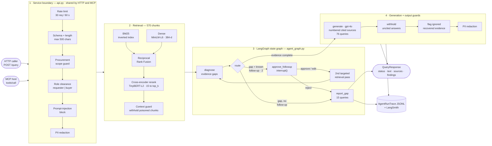
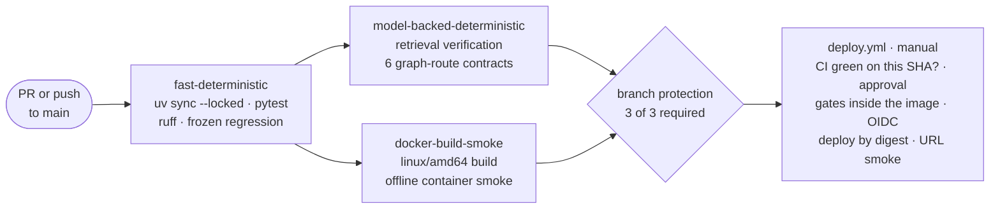

# ProcureRAG

[](https://github.com/juanfpinzon/ProcureRAG/actions/workflows/ci.yml)

**A production-shaped RAG system for procurement knowledge — built from primitives, then measured at every layer.**

ProcureRAG answers procurement questions ("What approval is required for a EUR 60,000
purchase order?") from a synthetic corporate knowledge base of policies, procedures,
supplier contracts and FAQs. Retrieval is written by hand — TF-IDF, BM25, an inverted
index, dense embeddings, Reciprocal Rank Fusion, cross-encoder reranking — so the
trade-off between lexical and dense retrieval is visible in the code rather than hidden
behind a library call. Frameworks (LangGraph, LangChain, DeepEval, RAGAS, FastAPI, MCP)
are layered on top only where they earn their place, and the reason is written down.
The finished service is one guarded pipeline behind two thin adapters — an HTTP API and
an MCP tool — shipped as a self-contained container through eval-gated CI/CD to Azure
Container Apps.

The thing that distinguishes this repo is not the feature list: it is that **every claim
has a number and a documented limit.** Nine retrieval configurations are scored on a
93-query labeled set with graded relevance; the reranker's weakest query slice is
measured, root-caused to two specific queries, and used to motivate the agentic layer;
the guardrails are mutation-tested; the container is probed offline; every merge to
`main` must pass the retrieval and graph-route regressions; the deployed image was gated
inside itself, shipped by digest, and rolled back for real. Where something does not
work — including the one live answer-quality check, which is red — it is in
[Known limits](#known-limits--not-built-yet), not quietly omitted.

```
Python 3.11 · uv · numpy · sentence-transformers · LangGraph 1.2 · LangChain 1.4
FastAPI · Uvicorn · Pydantic v2 · MCP Python SDK 2.3 · DeepEval · RAGAS · LangSmith
Docker · GitHub Actions · Azure Container Apps · OIDC
438 tests · ruff clean · 3 required CI checks on main · no LLM credentials needed to run the suite
```

---

## Contents

- [What this demonstrates](#what-this-demonstrates)
- [Architecture](#architecture)
- [Measured results](#measured-results)
- [Production path: CI/CD, Azure, MCP](#production-path-cicd-azure-mcp)
- [Where it still fails](#where-it-still-fails)
- [Corpus and golden query set](#corpus-and-golden-query-set)
- [Quickstart](#quickstart)
- [API surface](#api-surface)
- [Repo map](#repo-map)
- [How this was built](#how-this-was-built)
- [Known limits / not built yet](#known-limits--not-built-yet)
- [Documentation index](#documentation-index)

---

## What this demonstrates

| Capability | Implementation | Evidence |
|---|---|---|
| **Lexical retrieval from scratch** | Inverted index, TF-IDF, BM25 — no retrieval library | [`src/retrieval.py`](src/retrieval.py) · [eval report](docs/eval-report.md#baseline-table-unfiltered-text-retrieval) |
| **Dense retrieval** | `multi-qa-MiniLM-L6-cos-v1` embeddings, cosine similarity, hand-rolled | [`src/semantic_search.py`](src/semantic_search.py) |
| **Chunking** | Sentence-window chunks (3 sentences, overlap 1), 34 docs → 570 chunks | [`src/chunking.py`](src/chunking.py) · [`src/chunked_search.py`](src/chunked_search.py) |
| **Hybrid fusion** | RRF and weighted fusion over BM25 + dense, at document *and* chunk granularity | [`src/hybrid_search.py`](src/hybrid_search.py) |
| **Two-stage reranking** | Cross-encoder (`ms-marco-TinyBERT-L2-v2`) over a 15-chunk shortlist, every first-stage score preserved for audit | [`src/reranking.py`](src/reranking.py) |
| **Retrieval evaluation** | P@1 / R@5 / MRR@10 / nDCG@5, nine methods, 93 queries, plus error slices by query type, difficulty and filter | [`src/eval_metrics.py`](src/eval_metrics.py) · [eval report](docs/eval-report.md) |
| **Grounded generation** | Numbered source contract; every `[n]` traced back to a real chunk or flagged as an orphan citation | [`src/generation.py`](src/generation.py) |
| **Generation evaluation** | Four deterministic checks (citation validity, context recall, completeness, grounding) | [`src/generation_eval.py`](src/generation_eval.py) |
| **LLM-as-judge** | DeepEval + RAGAS faithfulness and contextual recall, with an honest `skipped`/`blocked`/`ok`/`error` contract | [`src/framework_eval.py`](src/framework_eval.py) |
| **Error analysis** | A failure taxonomy over five real cases, each with a human-assigned root cause and an owner (retrieval vs. generation) | [`src/error_analysis.py`](src/error_analysis.py) |
| **Regression suite** | Frozen cases that fail loudly (exit 1) when retrieval drifts, including a *tracked, expected* gap | [`src/regression_suite.py`](src/regression_suite.py) |
| **Agentic retrieval** | A bounded one-extra-pass recursive loop, triggered by computed evidence gaps — never by re-reading generated prose | [`src/agentic_retrieval.py`](src/agentic_retrieval.py) |
| **State graph** | The same control flow as an explicit LangGraph `StateGraph` with a deterministic router | [`src/agent_graph.py`](src/agent_graph.py) |
| **Checkpointing / HITL / time travel** | `InMemorySaver`, `interrupt()` approval gate (approve / edit / reject), state replay per `thread_id` | [`src/agent_control_plane.py`](src/agent_control_plane.py) |
| **Observability + structured output** | Pydantic-validated `AgentRunTrace` (JSONL, versioned schema) and `AgentResult`; LangSmith root runs linked to local rows | [`src/agent_observability.py`](src/agent_observability.py) · [traces](docs/traces/) |
| **Guardrails** | One guard per layer — input, retrieved context, action, output — mapped to the OWASP LLM Top 10 (2025) | [`src/agent_guardrails.py`](src/agent_guardrails.py) · [mapping](docs/eval-report.md#owasp-top-10-for-llm-apps-2025-procurerag-mapping) |
| **Serving** | FastAPI with SSE streaming, role-based confidentiality filtering, rate limiting, scope guard | [`src/api.py`](src/api.py) |
| **MCP server** | One read-only tool over stdio — a thin adapter over the same guarded service as `POST /query`; the reviewer's approval comes from the user via MCP elicitation, never from the model | [`src/mcp_server.py`](src/mcp_server.py) · [eval report](docs/eval-report.md#day-25-mcp-servertool-and-week-5-gate-review) |
| **Containerization** | Non-root image, CPU-only `torch`, both models baked in (starts with no network), secret boundary, health check | [`Dockerfile`](Dockerfile) · [runbook](docs/docker-runbook.md) |
| **Graph route regression** | Six committed contracts — route, retrieval passes, approval, stop reason, missing evidence, LLM-call count — checked on real retrieval; exit 1 on drift, 2 on infrastructure | [`src/graph_regression.py`](src/graph_regression.py) |
| **Eval-gated CI** | Three required checks on `main`: unit + lint, model-backed retrieval + graph regression, Docker build + container smoke. SHA-pinned actions, read-only token, a deliberate red proven | [`ci.yml`](.github/workflows/ci.yml) · [`scripts/container_smoke.py`](scripts/container_smoke.py) |
| **Cloud deployment** | Azure Container Apps through a protected, OIDC-authenticated workflow: the image is gated inside itself offline, deployed by digest, smoked through its URL; one real rollback | [`deploy.yml`](.github/workflows/deploy.yml) · [runbook](docs/azure-container-apps-runbook.md) |

---

## Architecture



The route distribution over the 93 labeled queries is **76 direct `generate` / 2
approval-gated second pass / 15 `report_gap`** — measured, not designed. The two
second-pass queries (Q091, Q092) are exactly the two failures the Week 3 evaluation
root-caused; `report_gap` is what the system does instead of answering when required
evidence never reached context.

**Design decisions worth asking about:**

- **Low-level `StateGraph`, not `create_agent`.** There is no tool-calling model loop to
  wrap: the router is deterministic code, and the only action is one extra retrieval
  pass. The trade-off is written up in [Day 18](docs/eval-report.md#current-api-decision-low-level-stategraph-vs-create_agent) rather than papered over.
- **Hybrid guardrails.** LangChain's `PIIMiddleware` detectors where one fits (the card
  detector runs Luhn, so a 16-digit reference number is not mistaken for a card), local
  regex where none does. Guardrails AI and Presidio were deliberately *not* adopted —
  both need network installs or model downloads, so neither runs in CI.
- **Chunk-level fusion before reranking.** The reranker is benchmarked against the
  strongest first stage (chunk-level hybrid RRF), not a weaker one that would flatter it.
- **MCP is a second adapter, not a second pipeline.** The tool calls
  `api.run_query_events`, the same function behind `POST /query`, so the input guards,
  role filter, approval gate and output guard cannot drift between the two surfaces. A
  parity test checks that the same requests get the same response both ways, and a
  deliberate mutation that called the graph directly, around the guards, is caught by the
  test suite.
- **Approval comes from the user, not the model.** Over HTTP the reviewer's decision is a
  request field; as a tool argument, the host's model could approve its own follow-up.
  So the MCP tool has no `decision` argument at all: the server asks the user through MCP
  elicitation, and every way of not getting an answer fails closed to
  `pending_approval`, with nothing retrieved.

---

## Measured results

Nine retrieval configurations, all 93 labeled queries, 34 documents, 570 chunks.
Reproduce with `uv run python src/eval_metrics.py` (~16 s on a laptop CPU).

| Method | Retrieval unit | P@1 | R@5 | MRR@10 | nDCG@5 |
|---|---|---:|---:|---:|---:|
| TF-IDF | document | 0.871 | 0.787 | 0.924 | 0.818 |
| BM25 | document | 0.860 | 0.754 | 0.910 | 0.792 |
| Dense (multi-qa-MiniLM) | document | 0.839 | 0.673 | 0.900 | 0.740 |
| Dense (multi-qa-MiniLM) | chunk→document | 0.925 | 0.768 | 0.954 | 0.828 |
| Hybrid RRF (BM25 + dense) | document | 0.860 | 0.763 | 0.922 | 0.799 |
| Hybrid weighted, α=0.5 | document | 0.882 | 0.775 | 0.938 | 0.822 |
| Hybrid RRF (BM25 + dense) | chunk→document | 0.935 | **0.811** | 0.965 | 0.863 |
| Hybrid weighted, α=0.5 | chunk→document | 0.925 | 0.801 | 0.961 | 0.851 |
| **Cross-encoder reranked Hybrid RRF** | chunk→document | **0.978** | 0.806 | **0.984** | **0.869** |

Relevance is binary via `expected_relevant_ids` for P@1/R@5/MRR@10, and graded
(primary = 2, secondary = 1) for nDCG@5. Every ranked list is cut to depth 10 before
scoring, so MRR is MRR@10, not an unbounded MRR. Full methodology, the filter-adjusted
table, and the tie-break analysis are in [`docs/eval-report.md`](docs/eval-report.md).

**What the numbers actually say:**

- **Changing the retrieval unit beat changing the algorithm.** Moving dense retrieval
  from whole documents to chunks is +0.086 P@1 — a bigger gain than any fusion method
  delivered at document level. Hybrid fusion only earns its place *once it fuses over
  the right unit*: at document level, hybrid RRF (0.860) does not beat TF-IDF (0.871).
- **The reranker is a precision tool, not a recall tool.** P@1 +0.043 and MRR@10 +0.019,
  while R@5 moves −0.005. That is the expected shape: reranking only re-orders the same
  15-chunk shortlist, so it cannot pull in a document the first stage never retrieved.
  A sharp P@1 gain alongside flat R@5 is evidence the reranker is doing its own job
  rather than compensating for a weak first stage.
- **nDCG@5 breaks every P@1 tie and shows the remaining headroom.** The reranked row is
  0.978 P@1 but only 0.869 nDCG@5: ranking the *primary* document first is a measurably
  harder bar than ranking *any* relevant document first.

Serving and container measurements (LLM off; latency medians are n=10 from one client —
not a load test):

| Measurement | Value |
|---|---|
| Image size | 1.98 GB `linux/arm64`, both models baked in (1.87 GB before the bake; 6.58 GB before the CPU-only fix — see below) |
| Cold start to `healthy`, local | 9–10 s unconstrained; 26.5–28.5 s capped at 1 CPU / 2 GiB, the Azure shape (28.2 s on the GitHub runner) |
| Warm `/health`, local loopback | median 2.7 ms |
| Warm `/query` (single pass), local loopback | median 39.3 ms |
| Two-pass `/query` (Q091 + approve) | 99 ms |
| Memory, one worker | 572 MiB steady; 700 MiB peak under a 2 GiB cap |
| Azure cold start from scale-to-zero | 59–72 s (scheduling, a 17.5 s image pull, model load, startup probe) |
| Azure warm `/health` / `/query` over the public FQDN | ~150 ms / ~219 ms client-side, new TLS connection each time |

> **A finding worth the space:** the first image was 6.58 GB, and 4.2 GiB of that — 67%
> of the virtualenv — was CUDA libraries that a CPU-only service never loads. PyPI's
> Linux `torch` wheel is the CUDA build. Pointing `torch` at PyTorch's CPU-only index
> for Linux only ([`pyproject.toml`](pyproject.toml)) cut the image to 1.87 GB with
> identical retrieval results. The subtlety: `[tool.uv.sources]` applies to *direct*
> dependencies only, so `torch` has to be listed explicitly even though ProcureRAG never
> imports it — leave it out and Linux silently gets the CUDA build back.

---

## Production path: CI/CD, Azure, MCP

### Eval-gated CI



- **Three required checks**, pinned to the GitHub Actions app so a same-named status from
  anywhere else cannot satisfy them, with `enforce_admins` on so the rule binds the repo
  owner too. The slow jobs `needs:` the cheap one, so a red is always attributed to the
  cheapest failing layer. A full run takes 2–4 minutes.
- **A gate has to be able to fail.** Before CI existed, `regression_suite.py` printed
  "N case(s) no longer match" and exited 0: it was not a gate. It now exits 1 on drift
  and 2 when the models cannot load, so a Hugging Face outage reads as "could not check",
  never as "retrieval regressed". A deliberately wrong contract was then pushed to prove
  it: CI went red in 32 s at the cheapest layer and skipped the slow jobs.
- **Supply-chain hygiene.** Every action is pinned to a full commit SHA verified against
  its own repository; the token is `contents: read`; PRs run under `pull_request`, never
  `pull_request_target`; the Docker layer cache is written only from `main`, so PR code
  cannot plant layers a later `main` build reuses.
- **The paid live lane is separate and manual.** `live-eval.yml` runs only on `main`,
  behind a protected environment whose reviewer must approve before the provider key
  exists in the job, with a hard budget of two LLM calls per run enforced in code. It is
  not a merge gate — and its first run is red ([Where it still fails](#where-it-still-fails)).

### Deployment to Azure Container Apps

Deployed by hand from a runbook first, then through `deploy.yml`. The revision contract
lives in [`deploy/azure/containerapp-template.yaml`](deploy/azure/containerapp-template.yaml):
1 vCPU / 2 GiB, scale 0–1, custom HTTP startup / readiness / liveness probes on
`/health` (Container Apps ignores Docker's `HEALTHCHECK`), image pulled with the app's
managed identity, and no secret at all in the deterministic revision.

- **No cloud secret in GitHub.** The deploy job signs in with OIDC: a short-lived token
  that only a job in the `production` environment (branch `main`, required reviewer) can
  obtain. Its identity holds `AcrPush` on the registry and `Contributor` on the one app.
- **The deployed bytes are the gated bytes.** The workflow refuses unless CI passed on that
  exact commit, builds once, runs the container smoke *and* the retrieval and graph-route
  regressions inside the image with `--network none`, then pushes that image, deploys it
  **by digest**, waits for Azure to report the new revision ready on that digest, and
  smokes it through its public URL.
- **Rollback is a digest, and it was exercised.** The pipeline records the previous image's
  digest. Applying it created a new revision running exactly those bytes with 100% of the
  traffic, confirmed in Azure's Activity Log — not inferred from a passing smoke, because
  both images answer the smoke identically.
- **The sign-in failed closed when the trust was wrong.** The first deploy was refused by
  Entra ID (`AADSTS700213`): the federated credential's subject differed from GitHub's
  by one stray character. Nothing was pushed and the app was never touched.
- **Every target was deleted the same day.** An unauthenticated public endpoint is not
  something to leave running. Nothing is live today; the runbook recreates it.

> **A finding worth the space:** no image input changed across four builds — not the
> Dockerfile, the lockfile, the code or the corpus — yet the laptop produced `a03b392b…`
> twice and the GitHub runner produced `ba8cb277…` twice. Each builder reproduces its own
> bytes from its own cache; the two never agree. "Same commit" does not mean "same
> image" — which is why the deploy job gates the bytes it pushes, not the commit it came
> from.

### MCP server

One tool, `answer_procurement_question`, served over stdio (MCP Python SDK 2.3.0,
protocol `2026-07-28`) and annotated `readOnlyHint`. Arguments: `query`, `role`, and an
optional `query_id` for labeled replay. The output schema is the HTTP API's own
`QueryResponse`, unchanged.

Evidence in layers, each proving something the previous one cannot: 41 tests through the
adapter and the SDK's own in-memory client (discovery, schemas, approve / edit / reject,
blocked and invalid calls, the role filter, HTTP parity); a real stdio client that
starts the process, loads the models once and makes five representative calls, on macOS
and in a Linux container; and the official MCP Inspector CLI as an independent client.
16 of 16 and 7 of 7 deliberate faults in the server were caught by the tests.

What building it surfaced:

- **The `.env` fallback would have made every MCP call a paid call.** The SDK's stdio
  client launches the server with an allow-listed environment, so the live-LLM switch
  would have been read from the repo's `.env`, where it is on. The server now treats "no
  switch in the launch environment" as off — tested both ways.
- **The SDK sanitizes a crash's result, not its log.** A fake API key inside a provider
  timeout appeared verbatim in the server's stderr traceback. A crash now logs the
  exception type only and returns a fixed message.
- **Unknown arguments are dropped, not refused** — where HTTP answers 422. A `decision`
  the model sends anyway simply disappears, which is why approval had to move out of the
  arguments altogether and into elicitation.

---

## Where it still fails

This section exists because an aggregate number hides the interesting part.

**`multi_doc` is the reranker's weakest slice, and the only one where it loses to its own
first stage.** Error slices by query type (`src/eval_metrics.py`):

| Query type | n | Hybrid RRF chunk→doc (P@1) | Reranked (P@1) |
|---|---:|---:|---:|
| conceptual | 17 | 0.941 | 1.000 |
| lookup | 23 | 0.957 | 1.000 |
| **multi_doc** | 5 | 0.800 | **0.600** |
| numeric | 7 | 0.857 | 1.000 |
| procedural | 14 | 0.929 | 1.000 |
| supplier_specific | 13 | 1.000 | 1.000 |
| terminology | 6 | 1.000 | 1.000 |
| threshold | 8 | 0.875 | 1.000 |

Traced to two specific queries rather than left as a slice-level observation:

- **Q091** ("What approvals and security evidence do I need for a EUR 120,000 SaaS
  renewal?") retrieves `POL-001`, but not the *chunk* carrying the actual Band 3
  threshold sentence. The answer therefore cannot state the threshold — and correctly
  says so instead of guessing.
- **Q092** ("What do we need to complete before a new cleaning contractor starts on
  site?") misses `CONTRACT-005` and `POL-002` entirely, at document level. Two different
  causes: a reranker-judgment miss a bigger pool cannot fix, and a fusion+reranker miss
  that a diagnostic `pool_size=200` still left outside the cutoff.

**What fixed them was not depth.** A second retrieval pass with a query reformulated
from the missing clauses' own vocabulary ("Enhanced Due Diligence", "Legal approval",
"recruitment fees") recovered Q091's missing chunk and both of Q092's missing documents.
The mechanism matters: a cross-encoder scores `(query, candidate)` jointly, so changing
the query text changes the score — which a bigger candidate pool cannot do. That measured
ceiling is the entire reason the agentic layer exists, instead of "agents" as a generic
next feature.

**Fixing retrieval did not fix the answer.** The one live graph-path evaluation (gpt-4o,
the manual CI lane) passed Q001 and the Q092 abstention, but **failed Q091**. The
recursive pass repaired the Band 3 threshold — the answer now states it, with a valid
citation — yet the answer drops the renewal usage-data step that `expected_answer`
requires. The evidence was in context; it was lost in generation over 19 merged sources.
The failure was predicted from stored traces before the run, and the curated terms were
not edited to turn it green.

**What is still broken, in plain terms:**

- **Q091's live answer is incomplete**, as above. The owner is generation, not retrieval
  or routing, and it is open.
- **The live quality check is thin.** One run is one sample, and the check is a literal
  term match: it catches a missing fact cheaply, but fails a correct paraphrase and
  cannot judge correctness. Earlier, every live `answered` row in the Day 19 run was
  incomplete against its `expected_answer`, and two were wrong (Band 4 instead of Band 3;
  a contract applied to the wrong supplier category). Structured output guarantees
  shape, not truth.
- The recursive trigger reads gold labels to detect a gap, so the agentic path only runs
  on the 93 labeled queries. It is eval-time machinery, not production machinery.
- Follow-up queries come from a hand-written table, not a model.
- The 15 `report_gap` queries have no policy beyond "refuse and report".

---

## Corpus and golden query set

Everything is synthetic and non-confidential — written for this project, modeled on a
fictional company ("Vantera"). Two versions are kept, deliberately:

| | `data/corpus_v0/` | `data/corpus_v1/` |
|---|---|---|
| Documents | 10 | 34 |
| Words / doc | ~60 | 725–913 (mean 827) |
| Chunks | 13 | 570 |
| Queries | 8 | 93 |
| TF-IDF P@1 | **1.00** | 0.871 |

v0 scored 1.00 and therefore measured nothing: every planned Week 2 improvement would
have shown up as no change at all. v1 was built so the benchmark could move. v0 is kept
untouched as the small, inspectable corpus the primitives were written against.

The v1 golden set ([`example_queries.jsonl`](data/corpus_v1/example_queries.jsonl)) is
the single canonical query source — no duplicate `golden_queries.jsonl` to drift out of
sync. Each of the 93 rows carries `expected_relevant_ids`, graded `relevance_grades`
(primary / secondary), `metadata_filters`, an `expected_answer`, verbatim evidence
quotes, a `query_type` and a `difficulty`. Gold sets average 2.7 relevant documents per
query, which is why R@5 sits well below P@1. Documents carry `confidentiality`
(24 `Internal`, 10 `Confidential`), which the API enforces per role.

Provenance and validation: [`docs/corpus-v1.md`](docs/corpus-v1.md). The recurring
hand-test and smoke queries, with their exact text and expected behavior:
[`docs/test-queries.md`](docs/test-queries.md).

---

## Quickstart

Requires Python 3.11+ and [uv](https://docs.astral.sh/uv/).

```bash
uv sync
```

No API keys are needed for the test suite, the retrieval evaluations, the guardrail
scenarios, the API's deterministic path, or the MCP server. A live LLM call is always
opt-in.

### Gates

The same commands CI runs as required checks:

```bash
uv run pytest                                   # 438 tests, no credentials, ~3 s
uv run ruff check src tests scripts             # lint
uv run python src/regression_suite.py           # frozen cases; exit 1 on drift
uv run python src/regression_suite.py --verify-retrieval   # frozen cases vs. the live pipeline
uv run python src/graph_regression.py           # six graph-route contracts on real retrieval
```

### Explore the retrieval layers

Each module is runnable on its own and prints a worked example against the corpus.

```bash
uv run python src/retrieval.py            # TF-IDF + BM25 over the inverted index
uv run python src/semantic_search.py      # dense retrieval
uv run python src/chunked_search.py       # whole-document vs. chunk-level dense
uv run python src/hybrid_search.py        # BM25 + dense fused (RRF and weighted)
uv run python src/reranking.py            # two-stage cross-encoder reranking
uv run python src/eval_metrics.py         # the nine-method table above (~16 s)
```

### Explore the agentic layer

```bash
uv run python src/agentic_retrieval.py                      # the bounded recursive loop
uv run python src/agent_graph.py --all-queries-summary      # route distribution over all 93
uv run python src/agent_control_plane.py                    # checkpointing, HITL, time travel
uv run python src/agent_guardrails.py                       # 8 scripted guard scenarios, ~1.5 s
uv run python src/agent_guardrails.py --all-queries         # 93 queries, 0 false positives, ~20 s
```

### Run the API

```bash
uv run python -m uvicorn api:app --app-dir src --host 127.0.0.1 --port 8000
```

`--app-dir src` is required: the modules use flat sibling imports, so `uvicorn src.api:app`
fails with `ModuleNotFoundError`. Interactive docs at `http://127.0.0.1:8000/docs`.

```bash
curl -sS http://127.0.0.1:8000/health
# {"status":"ok","app":"ProcureRAG API","version":"0.1.0","live_llm":false}

curl -sS -X POST http://127.0.0.1:8000/query \
  -H 'Content-Type: application/json' \
  -d '{"query": "What approval is required for a EUR 60,000 purchase order?", "role": "buyer", "query_id": "Q001"}'
# {"status":"not_generated", ... 5 sources ..., "run_id":"..."}   ← retrieval ran, LLM is off

curl -sS -X POST http://127.0.0.1:8000/query \
  -H 'Content-Type: application/json' \
  -d '{"query": "What is the capital of France?", "role": "buyer"}'
# {"status":"blocked", "findings":[{"guard":"off_topic","layer":"input","action":"block", ...}]}
```

### Connect it to an MCP host

```bash
# A real stdio client: starts the server, discovers the tool, makes five representative calls
HF_HUB_OFFLINE=1 uv run python scripts/mcp_stdio_smoke.py

# Register it with Claude Code, live LLM off (run from the repo root)
claude mcp add procurerag -e PROCURERAG_LIVE_LLM=0 -e LANGSMITH_TRACING=false \
  -e LANGSMITH_TRACING_V2=false -e HF_HUB_OFFLINE=1 -- \
  uv run --directory "$(pwd)" python src/mcp_server.py

# Or inspect it in a browser (needs npx)
uv run mcp dev src/mcp_server.py
```

`HF_HUB_OFFLINE=1` assumes both models are already cached by an earlier run (any command
above that loads them). Ask about Q091: a host that supports elicitation shows the
approve / edit / reject form before any retrieval runs; a host that does not gets
`pending_approval`, with nothing run.

### Run it as a container

```bash
docker build --tag procurerag-api:local .
python3 scripts/container_smoke.py procurerag-api:local   # starts it offline at 1 CPU / 2 GiB, probes, cleans up
```

Both Hugging Face models (106 MB) are baked into the image at build time, so a container
starts with **no network and no mounted cache** — the same image shape runs locally, in
CI and on Azure. Manual run commands, expected output and troubleshooting:
[`docs/docker-runbook.md`](docs/docker-runbook.md). The cloud path, end to end:
[`docs/azure-container-apps-runbook.md`](docs/azure-container-apps-runbook.md).

### Opt into a live LLM (paid)

Put `OPENROUTER_API_KEY` in a gitignored `.env` and set `PROCURERAG_LIVE_LLM=1`. The
default generation model is `openai/gpt-4o`; the DeepEval/RAGAS judge is
`openai/gpt-4o-mini`. Nothing calls a provider unless both are present. For the MCP
server, the switch must be in the server's launch environment; the key still comes from
`.env` — never pass it with `-e`, which writes it into the host's config file.

---

## API surface

| Endpoint | Purpose |
|---|---|
| `GET /health` | Liveness and the `live_llm` flag. Never rate-limited, so platform probes cannot be throttled into a false "down". Never calls the provider. |
| `POST /query` | One question in, one user-safe `QueryResponse` out. |
| `POST /query/stream` | The same run as Server-Sent Events: `request_validated` → `guard_finding`* → `retrieval_started` → `result`. Progress without hiding safety decisions. |
| MCP `answer_procurement_question` | The same run as an MCP tool over stdio, with the same `QueryResponse` as its output schema. The reviewer's decision comes by elicitation, not as an argument. |

Request: `query` (≤ 500 chars), `role` (`requester` | `buyer`), optional `query_id` for a
labeled query, optional reviewer `decision` (`approve` | `edit` + `followup_query` | `reject`).

Response `status` is one of six values — four from the trace row (`answered`,
`model_declined`, `gap_report`, `not_generated`) plus two only the edge can know
(`blocked`, `pending_approval`). There is deliberately **no `error` status**: "the
evidence is missing" is a normal RAG outcome with its own status, and a crash is an
HTTP 500 (or, over MCP, an error result carrying a fixed message).

**What the boundary enforces before any retrieval runs:** sliding-window rate limit
(30 req / 60 s), schema and length validation (HTTP 422), a procurement scope guard,
prompt-injection block, PII redaction, and role-based confidentiality filtering. Two
details worth noting:

- **`pending_approval`, never silent auto-approval.** A question that may need the second
  retrieval pass returns the approval request and runs nothing. A reviewer resends the
  same request with an explicit decision — or, over MCP, answers the elicitation form.
- **The gap report is a side channel, and it is closed.** A gap report names the missing
  documents. After role filtering removed a confidential document, that sentence would
  tell a `requester` that a confidential document exists and is what they need — no
  content, but still a disclosure. `restricted_gap` replaces it with a generic message.

---

## Repo map

```
src/
  preprocessing.py        corpus loading, normalization, domain-aware tokenizer
  retrieval.py            inverted index, TF-IDF, BM25
  semantic_search.py      dense retrieval (MiniLM-L6, 384-d) + cosine similarity
  chunking.py             sentence-window chunker (3 sentences, overlap 1)
  chunked_search.py       chunk-level dense retrieval vs. whole-document
  hybrid_search.py        RRF + weighted fusion, metadata filtering
  reranking.py            cross-encoder second stage, per-query-type retrieval configs
  eval_metrics.py         P@1 / R@5 / MRR@10 / nDCG@5, error slices, the nine-method table
  generation.py           prompt augmentation, numbered sources, citation validation
  generation_eval.py      four deterministic answer checks
  framework_eval.py       DeepEval + RAGAS bridge (LLM-as-judge)
  error_analysis.py       failure taxonomy over five real cases
  regression_suite.py     frozen regression cases + live-pipeline verification
  graph_regression.py     six graph-route contracts (deterministic) + the live answer slice
  multi_doc_slice_eval.py the full five-query multi_doc remeasurement
  agentic_retrieval.py    bounded one-extra-pass recursive retrieval
  agent_graph.py          LangGraph StateGraph + deterministic router
  agent_control_plane.py  checkpointer, interrupt() approval gate, time travel
  agent_observability.py  AgentRunTrace / AgentResult, JSONL + LangSmith
  agent_guardrails.py     input / context / action / output guards
  api.py                  FastAPI boundary, SSE streaming, roles, rate limit
  mcp_server.py           MCP stdio server: one tool over the same guarded service

scripts/
  container_smoke.py      gates one built image (or a running URL): health, Q001, Q091, blocked, logs
  mcp_stdio_smoke.py      a real MCP stdio client against the real server process

.github/workflows/
  ci.yml                  three required checks on every PR and push to main
  live-eval.yml           manual, approval-gated, paid live answer-quality lane
  deploy.yml              manual, approval-gated, OIDC deploy to Azure by digest

tests/                    438 tests — no network, no credentials
data/corpus_v0/           10 tiny docs, 8 queries (the primitives' scratchpad)
data/corpus_v1/           34 docs, 93 graded queries (the benchmark)
deploy/azure/             Container Apps revision template (resources, probes, scale, env)
docs/                     day-by-day build log, eval report, runbooks, traces
Dockerfile                non-root, CPU-only torch, models baked in, offline at run time
```

---

## How this was built

Twenty-five build days, each one scoped to a single increment with a named course
source, an artifact, verification commands and a write-up. The working rules that shaped
the code:

- **From primitives first, frameworks second.** Weeks 1–3 build retrieval with numpy, the
  standard library and a sentence-transformer for embeddings — no retrieval or RAG
  framework. LangGraph appears on Day 17, *after* a hand-written loop with the same control
  flow already worked, so the framework expresses known behavior explicitly rather than
  supplying behavior nobody understands. Week 5 then takes the same service to HTTP, a
  container, CI, the cloud and MCP without forking the pipeline.
- **Every number is reproduced, not remembered.** The eval report records the exact
  command and the exact output. Two overclaims in an early draft were caught and are
  corrected in place rather than edited out.
- **Failures are artifacts.** `regression_suite.py` carries `retrieval-miss-q091` as a
  case whose verdict is `as_expected` *because the gap is named and checked* — a tracked
  known gap, not a silent failure or a skipped test. The red live eval is kept red.
- **Gates are proven red before they are trusted.** A deliberate bad commit turned CI red;
  a bad contract made the graph regression exit 1; an empty model cache made both
  model-backed gates exit 2 ("could not check"), never 1.
- **Guards and gates are mutation-tested.** 13 of 13 guardrail mutations were caught, with
  0 false positives across all 570 chunks, 93 queries and 93 reference answers; 19 of 19
  in the regression tooling; 23 of 23 in the MCP server.
- **Secrets never enter an image or a workflow log.** `ARG` leaks via `docker history`,
  `ENV` via `docker inspect`, and a copied `.env` stays in its layer forever. Verified: 0
  secret-like names in the image config and history, 0 `.env` files in the image, 0
  matches in the logs. In CI the provider key is an environment secret mapped into one
  step, and Azure is reached with OIDC — there is no cloud password to leak.
- **Cloud resources are disposable.** Each Azure target lived in its own tagged resource
  group, was deleted the same day once the evidence was recorded, and its deletion was
  read back.

---

## Known limits / not built yet

**Not built (next in the plan):**

- **No persistent deployment.** The Azure deployments were real, evidenced and deleted the
  same day; nothing is live today.
- **No authentication.** The role is caller-asserted over HTTP and model-asserted over
  MCP. Locally the port is published on host loopback only, precisely because the service
  is unauthenticated; the Azure endpoint was public only for the smoke window.
- **No remote MCP.** The server is stdio only — no Streamable HTTP transport, so no OAuth,
  TLS or ingress. The stdio smoke runs locally, not in CI.
- **No automatic rollback.** The pipeline records the rollback digest but cannot apply
  it; the one rollback was applied by hand, outside the approval gate. A revision that is
  ready but answers wrongly stays live until a person acts.

**Honest limits of what *is* built:**

- **The corpus is synthetic**, written for this project. Retrieval numbers are valid
  relative to each other on this benchmark; they are not a claim about real procurement
  archives.
- **Live answer quality is red on Q091, and barely measured elsewhere** (see
  [Where it still fails](#where-it-still-fails)). A valid API response is not a correct
  answer.
- **Injection detection is a deny-list** of regex phrasings. Paraphrases, other languages
  and encoded payloads get through. The structural controls carry more of the safety than
  the phrase list: no tools, approval-gated retrieval, and answers that must cite.
- **PII detection is a baseline**, not data-loss prevention: it misses names, addresses,
  IBANs and national phone formats without a `+`.
- **No NLI / entailment check.** A misread or wrong-scope source passes every guard — the
  exact failure mode the two wrong live answers exhibit.
- **State is in-process.** `InMemorySaver` is not durable; the rate limiter is per-worker
  (N workers means N× the effective limit), and behind the Azure ingress it sees the
  proxy's address, so all callers share one budget. The approval record has no reviewer
  identity: demo and CI evidence uses a labeled auto-approval that says so in the trace
  row, and over MCP the host could answer the form itself.
- **The deployed image is a second build of the commit, not CI's artifact.** It is fully
  gated inside itself, but base images are pinned by tag and model revisions are not
  pinned (each build log records them), so two builds of one commit can differ — and did.
- **The model-backed CI lane depends on the Hugging Face Hub.** It is uncached on
  purpose; a Hub outage turns it red ("could not check") and, as a required check, blocks
  merges.
- **Branch protection is one person deep.** The rule binds the admin, but there is no
  required reviewer on a one-person repo.
- **Trace rows keep raw model text**, so traces — local and LangSmith — are sensitive
  data stores.
- **Metadata filtering is equality-per-field only** (plus list membership for
  `risk_tags`). No OR, no numeric ranges.
- **Latency numbers are n=10 from one client** on one machine or one network. Not a load
  test; no p95, no Azure Monitor metrics.

---

## Documentation index

| Document | What it is |
|---|---|
| [`docs/eval-report.md`](docs/eval-report.md) | **The main evidence artifact.** Every measurement, with the command that produced it, the output, and the caveats. Start here. |
| [`docs/corpus-v1.md`](docs/corpus-v1.md) | Corpus shape, field semantics, provenance, validation, baselines |
| [`docs/corpus-v0.md`](docs/corpus-v0.md) | The original small corpus and why it was retired as a benchmark |
| [`docs/test-queries.md`](docs/test-queries.md) | The recurring manual and smoke queries: exact text, role, expected status |
| [`docs/docker-runbook.md`](docs/docker-runbook.md) | Build, run, probe, clean up — executed as written |
| [`docs/azure-container-apps-runbook.md`](docs/azure-container-apps-runbook.md) | Registry, Container Apps, OIDC trust, deploy and rollback — executed as written |
| [`docs/learning-log.md`](docs/learning-log.md) | Per-day evidence: what was read, what was built, what broke, what was learned |
| [`docs/day-01-*.md` … `day-25-*.md`](docs/) | Per-day route docs: course sources, objective, design decisions, review prompt |
| [`docs/traces/`](docs/traces/) | Real `AgentRunTrace` JSONL rows from live runs |

---

<sub>Synthetic data only. No real supplier, contract, or company information appears in
this repository.</sub>
